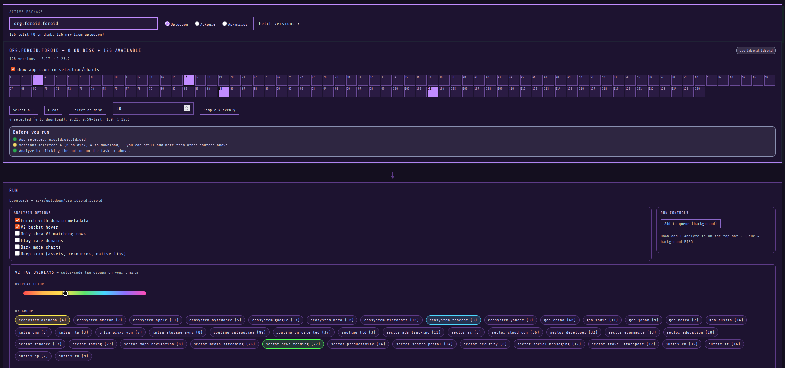

  <!---->
  
  <h1>Elkenson</h1>
  
<strong>Research-driven software and applied tools.</strong>

  

    
    
  

---
## What We Build
Research & Intelligence on Foreign Software 

## Featured Projects
- **Mercury** — version-aware Android analysis toolkit

  

  

---

  © Elkenson. All rights reserved unless stated otherwise.

