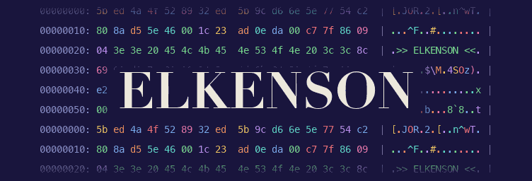
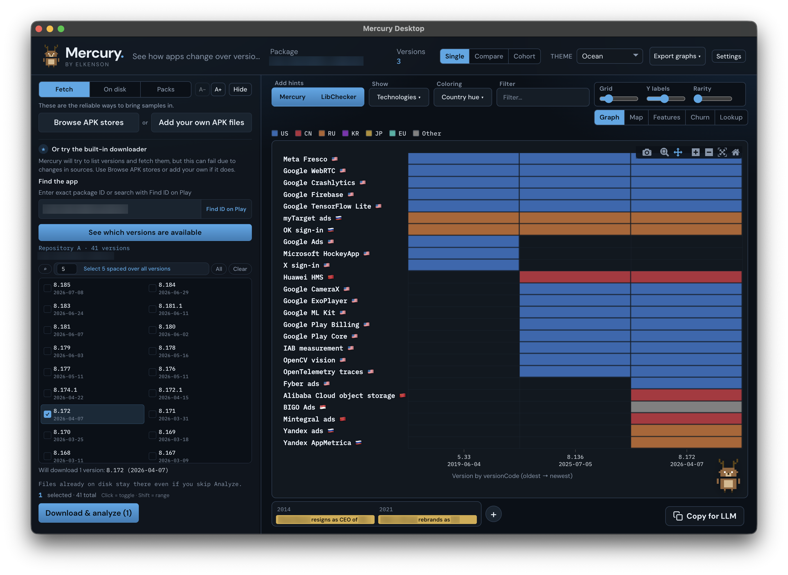

 

## Mercury Desktop

**Version-aware Android analysis.** Runs locally. Pull versions of an app from public stores (or drop in your own APKs), then see how its technologies, domains, hosts, endpoints and countries change from release to release.

## Contact

Need to know what's really inside an app, a supplier or understand a market?

[Discuss a project](https://www.elkenson.com/contact)

© Elkenson. All rights reserved unless stated otherwise.

 

